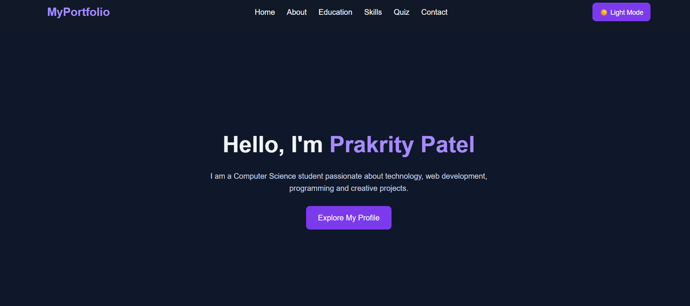

# Personal Portfolio Website

## Project Description
This is my personal portfolio website created to showcase my profile, education, skills, and projects.

## Features
- Home page with introduction
- About Me section
- Education details
- Skills section
- Interactive quiz
- Dark and Light mode
- Contact section
- Responsive design

## Technologies Used
- HTML
- CSS
- JavaScript

## Project Files
- index.html
- style.css
- script.js

## Screenshots
Portfolio homepage screenshot: Add your screenshot here.

## Live Website
Live URL: https://personal-portfolio-liart-delta-67.vercel.app/
